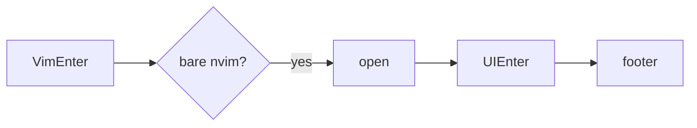

# PR

Every pull request body here follows
[.github/pull_request_template.md](../../../.github/pull_request_template.md).
Read it, fill each section as below, and delete its HTML comments. Keep the
`Before merging` checklist, ticking only what is true.

Skip preambles and keep prose brief. Use the words the code uses: doormat,
mark, wordmark, mask, menu, key, picker, highlight group, footer. Write in
English, whatever language the request came in. Add no "Generated with" line
or other attribution, for the same reason [AGENTS.md](../../../AGENTS.md)
forbids a co-author trailer in a commit.

## Summary

Pick the smallest view that makes the key point clear, and put a line of why
beside it. Link the issue with `Closes #N`, or `Related: #N` when the issue
stays open after this pull request.

- A visible change as the doormat drawn before and after, cut to the rows
  that moved:

```text
before:     s restore   f find   g grep   q quit
after:      s restore   f find   g grep   r recent   q quit
```

- A change to the menu or the highlights as a `diff`:

```diff
 local highlights = {
-	DoormatKey = { link = "DoormatLogoLightGreen" },
+	DoormatKey = { link = "Special" },
```

- When a key shows up as a table of conditions:

```text
key   shows up when
s     a readable recent file under cwd
f g   fff.nvim, fzf-lua or telescope is installed
```

- File responsibility or a broad refactor as a shallow file tree:

```text
plugin/doormat.lua     # opens on a bare nvim, :Doormat
lua/doormat/
├── init.lua           # menu, rendering, highlights
└── logo.lua           # mark, wordmark, masks
```

- Startup flow with Mermaid:



- The whole block when most of it is new, when omitted context would hide
  ownership or order, or when the reader needs a copyable target shape.

Place each visual next to the short text it supports. Keep only the keys,
groups and files needed to make the point. One view is usually enough, several
are sometimes needed, all of them never are.

## Evidence

Concrete evidence the change works: a before and an after.

- Screenshots of the doormat before and after are S-tier when the change is
  visible; the buffer text (`nvim_buf_get_lines`) when a screenshot is not to
  hand.
- For a key, the conditions tried and whether it showed up: with and without
  a picker, with and without a recent file. For a color, the resolved values
  from `nvim_get_hl(0, { name = ..., link = false })` under the default
  colorscheme and one that overrides the group. Both A-tier.
- `make check` green is the floor, not evidence. Say it only in the checklist.

## Merge Danger

**Door:** `one-way` or `two-way`. A two-way door is cheap to walk back. Here
the usual one-way doors are a menu key remapped or removed, a highlight group
users override in their config, the `:Doormat` command, and the `doormat`
filetype or module name.

**Blast Radius:** one word, then a line of what could break and for whom:
every startup, `nvim -` with stdin, one picker, users without lazy.nvim, a
colorscheme that sets `Doormat*` groups.
