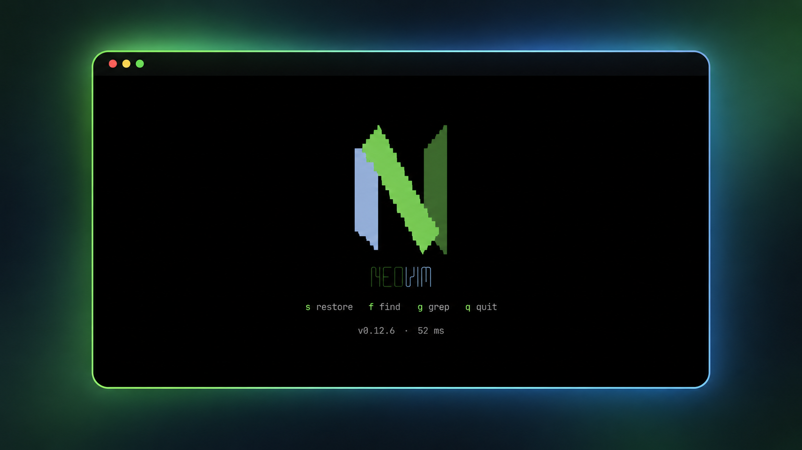

# doormat.nvim

_The very opinionated Neovim dashboard: a logo, four keys and your startup time._



Start `nvim` with no arguments and the doormat is there. Open anything and it
is gone. It works without any setup; the menu is the one thing you can change.

Needs Neovim 0.10 or newer.

## Installation

### [lazy.nvim](https://github.com/folke/lazy.nvim)

```lua
{ "kryptamine/doormat.nvim", lazy = false }
```

It has to load at startup: it opens on `VimEnter`.

### Without a plugin manager

```lua
vim.pack.add({ "https://github.com/kryptamine/doormat.nvim" })
```

`vim.pack` needs Neovim 0.12; on older versions clone the repository into a
`pack/*/start/` directory on your `packpath`.

## Usage

`:Doormat` opens it again in a new buffer.

## Menu

The default menu is `"restore"`, `"find"`, `"grep"` and `"quit"`. To change it, pass `items` to `setup()`: a list of
built-in names and your own items, drawn in that order.

```lua
require("doormat").setup({
  items = {
    "restore",
    { key = "n", label = "new", action = "<Cmd>enew<CR>" },
    { key = "f", label = "find", action = function() Snacks.picker.files() end },
    { key = "l", label = "lazy", action = "<Cmd>Lazy<CR>", cond = function() return package.loaded.lazy ~= nil end },
    "quit",
  },
})
```

With lazy.nvim the same table goes in `opts`. An item of your own has:

| field    | is                                                                  |
| -------- | ------------------------------------------------------------------- |
| `key`    | the key that runs it                                                |
| `label`  | the hint shown beside the key                                       |
| `action` | a function, or a mapping right-hand side such as `"<Cmd>enew<CR>"`  |
| `cond`   | optional: a function, and the item shows up only when it is true    |

A built-in item still shows up only when it can work, and `setup()` raises an
error on an item it cannot use.

## Colors

The mark follows your terminal colors. When the colorscheme sets the
`:terminal` palette (`g:terminal_color_N`), the mark takes its blue (4) and
bright green (10, or 2); the dark green is that green mixed half way into the
`Normal` background, since many palettes make green and bright green one
color. Without that palette the mark keeps the official Neovim colors below,
and without `termguicolors` it uses the terminal's own ANSI colors. The
cursor is hidden on the doormat when `termguicolors` is on. Every
group is set with `default`, so a colorscheme or your config can override any
of them:

| group                   | used for                     | default                          |
| ----------------------- | ---------------------------- | -------------------------------- |
| `DoormatLogoBlue`       | the mark's left bar, "neo"   | `#9fb2d6`, ANSI 4                |
| `DoormatLogoLightGreen` | the mark's diagonal          | `#8ac568`, ANSI 10               |
| `DoormatLogoGreen`      | the mark's right bar, "vim"  | `#476834`, ANSI 2                |
| `DoormatKey`            | the keys                     | links to `DoormatLogoLightGreen` |
| `DoormatHint`           | the key labels               | links to `Comment`               |
| `DoormatFooter`         | the version and startup time | links to `Comment`               |
| `DoormatCursor`         | the cursor, hidden           | `blend = 100`                    |

## License

[MIT](LICENSE)
